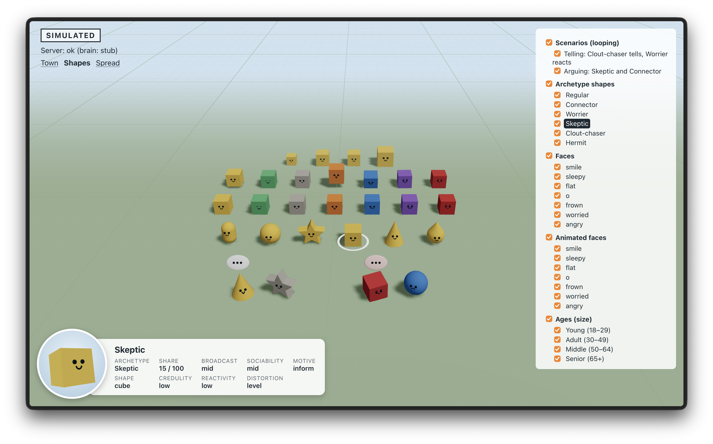

# Blobs

Master document for blob properties and interactions. Every rule is either cited or marked *(design)*. Full research list: [Research](./RESEARCH.md).

# Properties

```json
{
	"id": 3,
	"name": "Bob Pickle",
	"shape": "triangle",
	"age": 20,
	"traits": ["skeptic", "recluse"],
	"perception": 50,
	"interest": 20
}
```

- `id`: unique identifier.
- `name`: unique fictional name.
- `shape`: culture. Sets who the blob trusts most. See Shape.
- `age`: a number, distributed to match Canada. See Age.
- `traits`: personality tags. See Traits.
- `perception`: 0–100. What the blob thinks of the company. Starts at 50 *(design)*.
- `interest`: 0–100. How much the blob cares. Starts at 20 *(design)*.

No win or lose. Aim for both scores high by the end.

Perception and interest are separate. People share things they don't believe, so a blob can talk about the company a lot while thinking little of it [1], [2].

# Age

| Group | Ages | Share |
|---|---|---|
| Child | 0–17 | ~20% |
| Adult | 18–64 | ~60% |
| Elder | 65+ | ~20% |

Shares are from Canadian population estimates [3]. The child share is an estimate.

- **Children** believe their parents more than anyone else [4], [5]. Not guaranteed.
	- Under 13: read social media, don't post *(design)*. Platforms bar them, but many use it anyway [35].
	- 13–17: read and post like adults. Most teens use social media daily [36].
- **Elders** trust more, not less [6]. They miss warning signs [7] and share more questionable news online [8], because of digital literacy and source memory, not decline [9]. Elders don't get extra credulity; age changes trust and channel only.

# Traits

Three categories. Each has a low tag and a high tag. No tag = average.

| Category | Low | High | Meaning |
|---|---|---|---|
| **Credulity** | `skeptic` | `gullible` | How easily they believe what they hear [10], [11] |
| **Socialness** | `quiet` | `chatty` | How often they pass things on |
| **Persuasiveness** | `unconvincing` | `charismatic` | How much others believe them [12] |

- Most blobs have 2 tags; some have 1 or 3. Max 1 per category *(design)*.
- `chatty` is rare. A small minority does most of the sharing [13], [14].
- Tag names are drafts *(design)*.

# Special traits

- **Parent / Child:** belongs to a family. A family has at least 1 adult and 1 child. Single parents are common [15].
	- Families share a shape. Tags are rolled per blob: personality is only ~40% inherited [16].
	- Children trust their parents most [4], [5].
- **Recluse:** stays home. No in-person talking; social media only. Not more skeptical: loneliness links to *more* conspiracy belief [17].
- **Leader:** 1 per shape. Stays a leader. `charismatic`. Shares news from outlets with their shape. Real opinion leaders are local and several, not one for the whole town [18].

# Shape

Shape sets **who** a blob trusts most, not **how much** it believes; that's Credulity. Every shape has the same mix of traits, so no shape is "the gullible one" *(design)*.

How widely people trust differs between societies: some trust mainly their own group, others trust widely [19]. People trust sources like themselves more [20], [21].

| Shape | Trusts most | Basis |
|---|---|---|
| **Square** | Other squares | In-group trust [19], [21] |
| **Circle** | Everyone equally | Wide trust radius [19] |
| **Triangle** | Blobs their own age | Age is a major basis of homophily [20] |
| **Star** | Their shape's Leader | Opinion leaders [18] |
| **Tear** | Neighbours, any shape | Location is a basis of homophily [20] |
| **Capsule** | Their own family | Familism [22] |

# Interactions

Each round a blob talks, posts, or idles.

**Hearing about the company**
- How much it moves the listener's scores depends on the listener's credulity, the speaker's persuasiveness, and the listener's trust in the speaker (shape, family) [12], [21].
- Hearing it again counts *(design)*: repeated claims seem truer [23], and hearing from several people counts more than hearing from one twice [24].
- Alarming or surprising versions spread further [25]. Anxious blobs believe and share more [26].

**Passing it on**
- Chance to share = socialness + interest, not perception [1], [2].
- Retellings drift: details drop, the striking parts grow, and the story bends to fit the teller [27].
- Bridges between shapes (border blobs, mixed neighbours) carry news between groups [28].

**When the product ships**
- Perception moves by the gap between what was claimed and what was delivered [29].
- Blobs at the extremes (very happy or very angry) talk the most [30].
- Losses hit harder than gains [31].
- A debunked claim never fully wears off [32].
- Each broken promise makes the next claim land worse [33], [34].

# References

[1] G. Pennycook, Z. Epstein, M. Mosleh, A. A. Arechar, D. Eckles, and D. G. Rand, "Shifting attention to accuracy can reduce misinformation online," *Nature*, vol. 592, pp. 590–595, 2021.

[2] Z. Ren, E. Dimant, and M. Schweitzer, "Beyond belief: How social engagement motives influence the spread of conspiracy theories," *J. Exp. Soc. Psychol.*, vol. 104, Art. no. 104421, Jan. 2023, doi: 10.1016/j.jesp.2022.104421.

[3] Statistics Canada, "Canada's population estimates: Age and gender, July 1, 2025," *The Daily*, Sep. 24, 2025. [Online]. Available: https://www150.statcan.gc.ca/n1/daily-quotidien/250924/dq250924a-eng.htm

[4] M. K. Jennings, L. Stoker, and J. Bowers, "Politics across generations: Family transmission reexamined," *J. Politics*, vol. 71, no. 3, pp. 782–799, Jul. 2009.

[5] P. L. Harris and M. A. Koenig, "Trust in testimony: How children learn about science and religion," *Child Develop.*, vol. 77, no. 3, pp. 505–524, 2006.

[6] M. J. Poulin and C. M. Haase, "Growing to trust: Evidence that trust increases and sustains well-being across the life span," *Social Psychol. Pers. Sci.*, vol. 6, no. 6, pp. 614–621, 2015.

[7] E. Castle *et al.*, "Neural and behavioral bases of age differences in perceptions of trust," *Proc. Natl. Acad. Sci. USA*, vol. 109, no. 51, pp. 20848–20852, Dec. 2012, doi: 10.1073/pnas.1218518109.

[8] A. Guess, J. Nagler, and J. Tucker, "Less than you think: Prevalence and predictors of fake news dissemination on Facebook," *Sci. Adv.*, vol. 5, no. 1, Art. no. eaau4586, Jan. 2019.

[9] N. M. Brashier and D. L. Schacter, "Aging in an era of fake news," *Curr. Directions Psychol. Sci.*, vol. 29, no. 3, pp. 316–323, 2020.

[10] A. K. Teunisse, T. I. Case, J. Fitness, and N. Sweller, "I should have known better: Development of a self-report measure of gullibility," *Pers. Social Psychol. Bull.*, vol. 46, no. 3, pp. 408–423, 2020, doi: 10.1177/0146167219858641.

[11] G. Pennycook and D. G. Rand, "Lazy, not biased: Susceptibility to partisan fake news is better explained by lack of reasoning than by motivated reasoning," *Cognition*, vol. 188, pp. 39–50, Jul. 2019.

[12] D. Sterrett, D. Malato, J. Benz, L. Kantor, T. Tompson, T. Rosenstiel, J. Sonderman, and K. Loker, "Who shared it?: Deciding what news to trust on social media," *Digital Journalism*, vol. 7, no. 6, pp. 783–801, 2019, doi: 10.1080/21670811.2019.1623702.

[13] N. Grinberg, K. Joseph, L. Friedland, B. Swire-Thompson, and D. Lazer, "Fake news on Twitter during the 2016 U.S. presidential election," *Science*, vol. 363, no. 6425, pp. 374–378, Jan. 2019.

[14] G. Ceylan, I. A. Anderson, and W. Wood, "Sharing of misinformation is habitual, not just lazy or biased," *Proc. Natl. Acad. Sci. USA*, vol. 120, no. 4, Art. no. e2216614120, Jan. 2023, doi: 10.1073/pnas.2216614120.

[15] Department of Justice Canada, "Family structures in Canada, 1921 to 2024," 2026. [Online]. Available: https://justice.gc.ca/eng/rp-pr/jr/jf-pf/2026/fsc-sfc/index.html

[16] T. Vukasović and D. Bratko, "Heritability of personality: A meta-analysis of behavior genetic studies," *Psychol. Bull.*, vol. 141, no. 4, pp. 769–785, 2015, doi: 10.1037/bul0000017.

[17] K. Bierwiaczonek, S. Fluit, T. von Soest, M. J. Hornsey, and J. R. Kunst, "Loneliness trajectories over three decades are associated with conspiracist worldviews in midlife," *Nature Commun.*, vol. 15, Art. no. 3629, Apr. 2024, doi: 10.1038/s41467-024-47113-x.

[18] E. Katz and P. F. Lazarsfeld, *Personal Influence: The Part Played by People in the Flow of Mass Communications*. Glencoe, IL, USA: Free Press, 1955.

[19] J. Delhey, K. Newton, and C. Welzel, "How general is trust in 'most people'? Solving the radius of trust problem," *Amer. Sociol. Rev.*, vol. 76, no. 5, pp. 786–807, Oct. 2011, doi: 10.1177/0003122411420817.

[20] M. McPherson, L. Smith-Lovin, and J. M. Cook, "Birds of a feather: Homophily in social networks," *Annu. Rev. Sociol.*, vol. 27, pp. 415–444, 2001.

[21] C. S. Traberg and S. van der Linden, "Birds of a feather are persuaded together: Perceived source credibility mediates the effect of political bias on misinformation susceptibility," *Pers. Individ. Differ.*, vol. 185, Art. no. 111269, 2022, doi: 10.1016/j.paid.2021.111269.

[22] E. C. Banfield, *The Moral Basis of a Backward Society*. Glencoe, IL, USA: Free Press, 1958.

[23] G. Pennycook, T. D. Cannon, and D. G. Rand, "Prior exposure increases perceived accuracy of fake news," *J. Exp. Psychol.: Gen.*, vol. 147, no. 12, pp. 1865–1880, Dec. 2018, doi: 10.1037/xge0000465.

[24] D. Centola, "The spread of behavior in an online social network experiment," *Science*, vol. 329, no. 5996, pp. 1194–1197, Sep. 2010, doi: 10.1126/science.1185231.

[25] S. Vosoughi, D. Roy, and S. Aral, "The spread of true and false news online," *Science*, vol. 359, no. 6380, pp. 1146–1151, Mar. 2018.

[26] I. Freiling, N. M. Krause, D. A. Scheufele, and D. Brossard, "Believing and sharing misinformation, fact-checks, and accurate information on social media: The role of anxiety during COVID-19," *New Media Soc.*, vol. 25, no. 1, pp. 141–162, Jan. 2023, doi: 10.1177/14614448211011451.

[27] G. W. Allport and L. Postman, *The Psychology of Rumor*. New York, NY, USA: Henry Holt, 1947.

[28] M. S. Granovetter, "The strength of weak ties," *Amer. J. Sociol.*, vol. 78, no. 6, pp. 1360–1380, May 1973.

[29] R. L. Oliver, "A cognitive model of the antecedents and consequences of satisfaction decisions," *J. Marketing Res.*, vol. 17, no. 4, pp. 460–469, Nov. 1980, doi: 10.1177/002224378001700405.

[30] E. W. Anderson, "Customer satisfaction and word of mouth," *J. Service Res.*, vol. 1, no. 1, pp. 5–17, Aug. 1998, doi: 10.1177/109467059800100102.

[31] P. Slovic, "Perceived risk, trust, and democracy," *Risk Anal.*, vol. 13, no. 6, pp. 675–682, Dec. 1993.

[32] S. Lewandowsky, U. K. H. Ecker, C. M. Seifert, N. Schwarz, and J. Cook, "Misinformation and its correction: Continued influence and successful debiasing," *Psychol. Sci. Public Interest*, vol. 13, no. 3, pp. 106–131, Dec. 2012, doi: 10.1177/1529100612451018.

[33] S. Breznitz, *Cry Wolf: The Psychology of False Alarms*. Hillsdale, NJ, USA: Lawrence Erlbaum, 1984.

[34] K. Clayton *et al.*, "Real solutions for fake news? Measuring the effectiveness of general warnings and fact-check tags in reducing belief in false stories on social media," *Political Behav.*, vol. 42, pp. 1073–1095, 2020, doi: 10.1007/s11109-019-09533-0.

[35] MediaSmarts, "Young Canadians in a wireless world, phase III: Life online," Ottawa, ON, Canada, 2014. [Online]. Available: https://mediasmarts.ca/sites/default/files/pdfs/publication-report/summary/YCWWIII_Life_Online_ExecutiveSummary.pdf

[36] Pew Research Center, "Teens, social media and AI chatbots 2025," Washington, DC, USA, Dec. 2025. [Online]. Available: https://www.pewresearch.org
